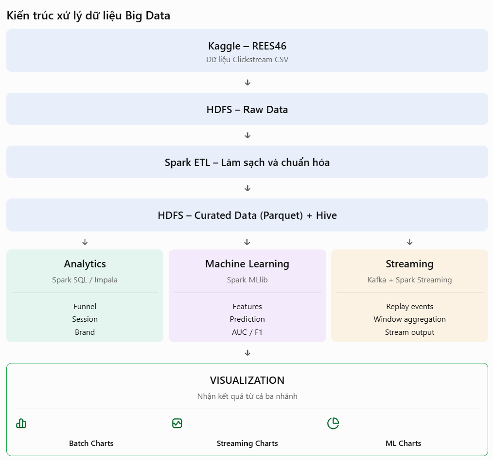

# Project Scope

## 1\. Mục tiêu

Xác định phạm vi dữ liệu, kiến trúc xử lý end-to-end và tiêu chí nghiệm thu của dự án xử lý dữ liệu clickstream REES46 trong giai đoạn P0. Dự án tập trung xử lý trọn bộ dữ liệu tháng 10/2019 và triển khai các nhánh Analytics, Streaming mô phỏng và Machine Learning offline trên cùng phạm vi dữ liệu.

## 2\. Phạm vi dữ liệu

|Thuộc tính|Phạm vi|
|-|-|
|Nguồn dữ liệu|REES46 – Ecommerce Clickstream CSV|
|Tệp dữ liệu được sử dụng|`2019-Oct.csv`|
|Khoảng thời gian sự kiện|Tháng 10/2019, theo múi giờ UTC|
|Phạm vi xử lý|Toàn bộ dữ liệu trong `2019-Oct.csv`|

## 3\. Kiến trúc xử lý end-to-end



```text
Kaggle – REES46
Dữ liệu Clickstream CSV (`2019-Oct.csv`)
              |
              v
        HDFS – Raw Data
              |
              v
   Spark ETL – Làm sạch và chuẩn hóa
              |
              v
 HDFS – Curated Data (Parquet) + Hive
              |
       +------+------+----------------+
       |             |                |
       v             v                v
   Analytics    Machine Learning   Streaming
 Spark SQL /       Spark MLlib     Kafka + Spark
   Impala                            Streaming
       |             |                |
       |             |                |
 Funnel, Session,  Features,       Replay events,
 Brand analysis   Prediction,      Window aggregation,
                  AUC / F1          Stream output
       |             |                |
       +-------------+----------------+
                     |
                     v
                Visualization
       Batch Charts | Streaming Charts | ML Charts
```

### 3.1. Lớp dữ liệu

* **Raw:** Lưu trữ dữ liệu nguồn trên HDFS.
* **ETL:** Sử dụng Spark để làm sạch và chuẩn hóa dữ liệu.
* **Curated:** Lưu dữ liệu đã xử lý dưới định dạng Parquet trên HDFS và khai thác thông qua Hive.

### 3.2. Các nhánh xử lý

* **Analytics:** Sử dụng Spark SQL/Impala để thực hiện phân tích Funnel, Session và Brand.
* **Machine Learning:** Sử dụng Spark MLlib cho quy trình tạo Features, Prediction và đánh giá mô hình bằng AUC/F1. Đây là nhánh huấn luyện offline.
* **Streaming:** Sử dụng Kafka kết hợp Spark Streaming để replay sự kiện, thực hiện window aggregation và tạo stream output. Kafka nhận dữ liệu replay từ dữ liệu lịch sử; đây là luồng streaming mô phỏng, không phải dữ liệu sự kiện trực tiếp từ website.

### 3.3. Visualization

Kết quả từ ba nhánh được thể hiện qua các nhóm biểu đồ tương ứng:

* Batch Charts cho Analytics.
* Streaming Charts cho Streaming.
* ML Charts cho Machine Learning.

## 4\. Tiêu chí nghiệm thu

Dự án được đánh giá trên phạm vi dữ liệu một tháng, các tiêu chí nghiệm thu gồm:

* Xử lý và làm sạch toàn bộ dữ liệu clickstream trong `2019-Oct.csv`.
* Kiểm chứng cân bằng số lượng bản ghi: **Raw = Curated + Rejected**.
* Thực hiện phân tích dữ liệu trên phạm vi tháng 10/2019.
* Triển khai luồng Streaming mô phỏng bằng cách replay dữ liệu lịch sử trong phạm vi tháng 10/2019.
* Huấn luyện và đánh giá mô hình Machine Learning offline trên phạm vi dữ liệu tháng 10/2019.

## 5\. Ranh giới phạm vi

|Hạng mục|Trong phạm vi|Ngoài phạm vi|
|-|-|-|
|Dữ liệu|`2019-Oct.csv`, thời gian UTC trong tháng 10/2019|Dữ liệu tháng 11/2019 và các tháng khác|
|Streaming|Replay dữ liệu lịch sử qua Kafka và xử lý bằng Spark Streaming|Thu nhận sự kiện live trực tiếp từ website|
|Machine Learning|Huấn luyện offline trên dữ liệu tháng 10/2019|Dữ liệu ngoài phạm vi tháng 10/2019|
|Nghiệm thu|Xử lý trọn dữ liệu tháng 10 và kiểm chứng `Raw = Curated + Rejected`|Xử lý dữ liệu của các tháng khác|


